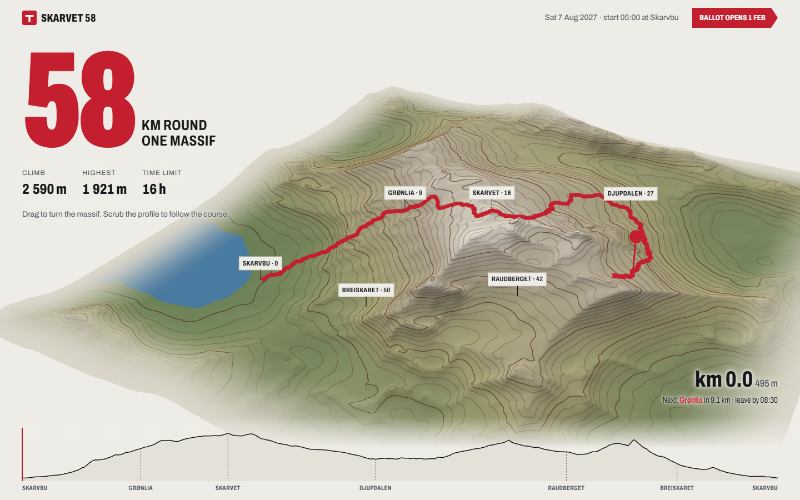

# Kern

**A design practice for AI agents, by [M4 Labs](https://m4labs.xyz).**

Kerning is the space a designer adjusts by eye after the font's own spacing is set. The metrics come with the tools, and the kerning is taste. Kern teaches an agent the second part. Instead of handing it a menu of styles to choose from, Kern gives it a method for deriving a design from the product itself, a canon of principles it never drops, an eye for finish, and tools that measure without choosing.

It covers websites, web apps, dashboards, desktop apps (macOS, Windows, Linux; Electron, Tauri, SwiftUI, AppKit, WinUI, GTK, Flutter), iOS and iPadOS, Android, watch, TV, car, kiosks, widgets, menu bar apps, browser extensions, visionOS, terminal UIs, slides, email, documents and print.

## Why outputs differ

Most design prompts converge, because every model reaches for the same average answer. Kern works against that in five ways:

- **It derives instead of selecting.** Each design starts from the brief's own specific facts, finds the tension in them, and writes a one-sentence thesis that has to fail when you swap in a competitor's name.
- **It names the median.** The agent writes down what an average model would ship for this exact brief, then treats it as presumed wrong.
- **It decides how loud to be.** A tax tool and a festival site should not differ only in accent colour. Kern reads the [register](skills/kern/references/register.md) from the brief, silent to spectacular, and picks the rich materials the product is actually made of: photography, archival plates, ASCII and text-mode animation, live 3D, generative data art, sound, play. Each one has to pass a relevance test, and then the agent commits to it.
- **It defends one risk.** Every design makes one decision a cautious designer would not, and it must come from the thesis.
- **It keeps a ledger.** Each project's fingerprint is recorded in `~/.kern/ledger.jsonl`, and new work is checked against it for near-duplicates.

## Install

**Claude Code** (as a plugin):

```text
/plugin marketplace add mowfxy/kern
/plugin install kern@m4labs
```

**Claude Code or Codex** (as skills), with Python 3.9+:

```sh
git clone https://github.com/mowfxy/kern.git
cd kern
python scripts/install.py                    # Claude Code: ~/.claude/skills
python scripts/install.py --target codex     # Codex: $CODEX_HOME/skills
python scripts/install.py --target both --remove-legacy
```

`--replace` updates an existing install, and `--remove-legacy` backs up and removes the design suite Kern replaces. Backups go to `.maintainer/install-backups/`. The tools in `skills/kern/scripts/kern.mjs` need Node 18 or later and nothing else.

## Use

```text
Use $kern to build a Tauri app for logging grape deliveries at a winery weighbridge.
```

```text
Use $kern-critique to rate this dashboard before and after the redesign.
```

Kern does not interview you about taste. It decides, builds, and tells you the thesis in a sentence or two so you can redirect it. It writes its working notes to `.kern/` in your project, and nowhere else.

## The suite

| Skill | Owns |
|---|---|
| [kern](skills/kern/SKILL.md) | The method, [canon](skills/kern/references/canon.md), [eye](skills/kern/references/eye.md), [median](skills/kern/references/median.md), [register](skills/kern/references/register.md), routing, tools |
| [kern-web](skills/kern-web/SKILL.md) | Landing pages, marketing sites, portfolios, editorial and event pages |
| [kern-product](skills/kern-product/SKILL.md) | Web apps, SaaS, forms, records, settings, every UI state |
| [kern-dashboard](skills/kern-dashboard/SKILL.md) | Dashboards built around decisions, charts, data colour, tables |
| [kern-desktop](skills/kern-desktop/SKILL.md) | Native desktop grammar and [title bars that belong to the app](skills/kern-desktop/references/chrome.md) |
| [kern-ios](skills/kern-ios/SKILL.md) | iPhone and iPad: HIG, Dynamic Type, Liquid Glass, edge-to-edge |
| [kern-android](skills/kern-android/SKILL.md) | Material 3, edge-to-edge, predictive back, adaptive layouts |
| [kern-screens](skills/kern-screens/SKILL.md) | Watch, TV, car, kiosk, widgets, menu bar, extensions, visionOS |
| [kern-terminal](skills/kern-terminal/SKILL.md) | CLI and TUI output, errors, progress, machine output |
| [kern-media](skills/kern-media/SKILL.md) | Slides, email, documents and PDFs, social images, print |
| [kern-type](skills/kern-type/SKILL.md) | Type derived from reading conditions; scales, numerals, scripts |
| [kern-color](skills/kern-color/SKILL.md) | Palettes from a real source, OKLCH ramps, themes, contrast |
| [kern-controls](skills/kern-controls/SKILL.md) | Icons, buttons, inputs and toggles drawn from the domain, not a kit |
| [kern-motion](skills/kern-motion/SKILL.md) | Motion from the product's physics: feedback, transitions, scroll, ASCII and text-mode, kinetic type, shaders, 3D cameras |
| [kern-imagery](skills/kern-imagery/SKILL.md) | Photography, open-collection sourcing, image treatments, illustration, live 3D, data art, characters |
| [kern-critique](skills/kern-critique/SKILL.md) | The Kern Score, before-and-after ratings, the look-and-fix loop |
| [kern-ship](skills/kern-ship/SKILL.md) | Working, honest, accessible, fast, found and secure |

## Examples

Three fictional products at three different registers, each built by running the method from scratch with its full record in `.kern/` ([details and scores](examples/README.md)):

- **[Rowtrack](examples/rowtrack/):** a terminal music tracker. The hero is a real pattern that scrolls row by row on a character grid, with a braille oscilloscope, block-element meters and a Web Audio synth you can play from your keyboard.
- **[Skarvet 58](examples/skarvet/):** a mountain race. The hero is the massif in live 3D with contour lines, the course drawing itself from the hut, and a profile you scrub to fly the camera along it. Every number is measured from the terrain.
- **[Wren Street Seed Library](examples/seed-library/):** a seed library in a branch library. Each variety is an index card carrying its 1904 Vilmorin engraving, and borrowing a packet stamps a due-back date in violet ink.

[](examples/skarvet/)

## Tools

```sh
node skills/kern/scripts/kern.mjs palette "#7a2e1f"              # OKLCH ramp from a source colour
node skills/kern/scripts/kern.mjs contrast "#1c1d1f" "#f4f3f0"   # WCAG 2 + APCA
node skills/kern/scripts/kern.mjs ledger check --fingerprint .kern/fingerprint.json
node skills/kern/scripts/kern.mjs audit src/                     # median tells, stock icons, motion safety, chrome
```

## Repository

- `skills/`: the suite.
- `.claude-plugin/`: the Claude Code plugin and marketplace manifests.
- `scripts/`: the installer, its tests and the validator.
- `evals/`: briefs and a protocol for measuring quality and divergence.
- `examples/`: three worked examples with their records.
- `docs/audit.md`: why Kern was built, with before and after ratings.

```sh
python scripts/validate.py
cd scripts && python -m unittest test_install
```

## License

[MIT](LICENSE) © 2026 M4 Labs.
