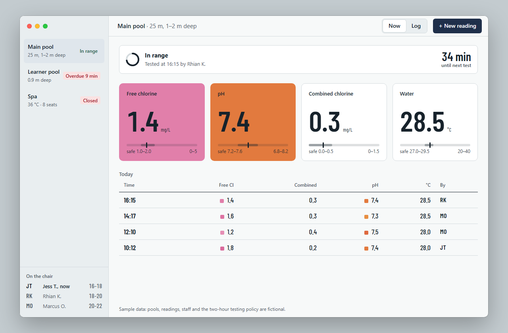
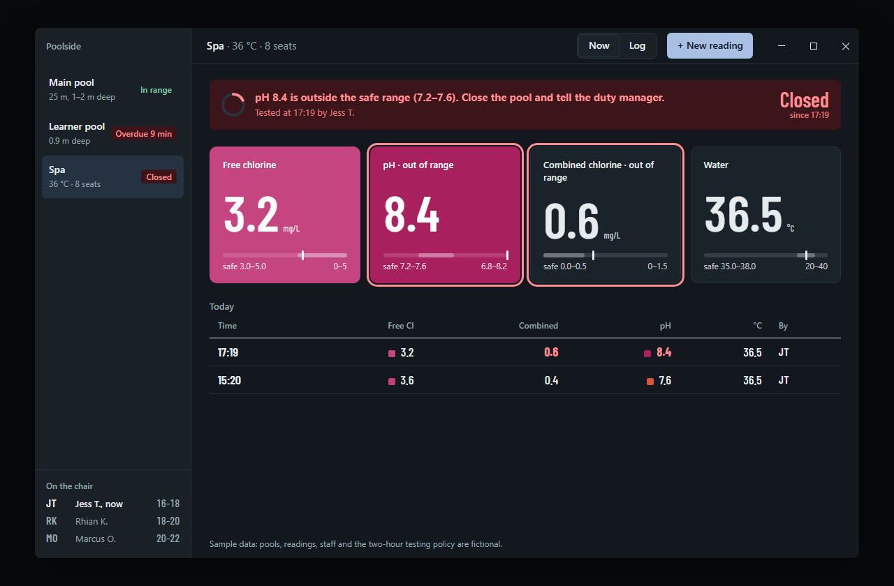
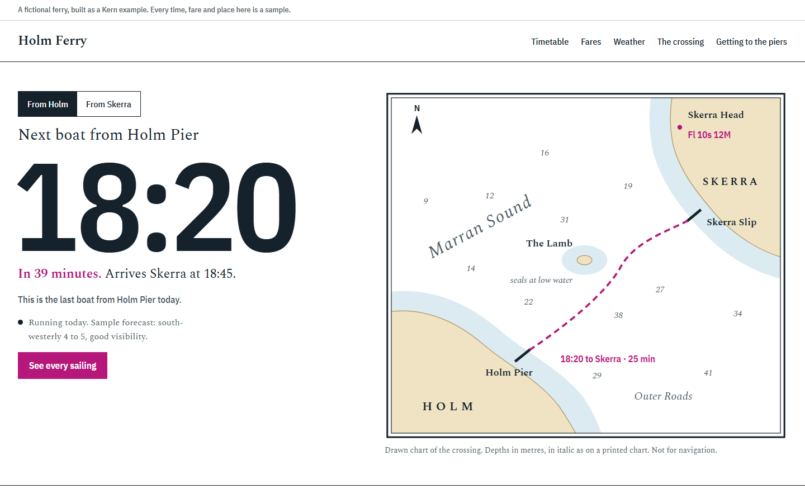

# Kern examples

There are two fictional products, each built by running the [Kern method](../skills/kern/references/method.md) from the start. Each one keeps its working notes in `.kern/record.md` (ground, tension, thesis, the median it left, the system and the defended risk) and its fingerprint in `.kern/fingerprint.json`. Read the record first. It shows how the design was derived, which matters more than the result.

They show reasoning, not templates. Kern does not reuse their layouts, palettes or typefaces for new work, and the ledger would flag a design that copied them.

[](poolside/)

[](poolside/)

[](holm-ferry/)

| | Poolside | Holm Ferry |
|---|---|---|
| Surface | Desktop app (Electron, macOS and Windows) | Public website |
| Thesis | The depth markings on the pool deck | The chart and timetable board at the head of the pier |
| Colour source | Pool-test comparator reagents, tiled lane line | The Admiralty nautical chart |
| Type | System UI plus Barlow Condensed numerals | Spectral (sea names always italic) plus IBM Plex Sans Condensed |
| Defended risk | The pH tile is filled with the comparator colour for that exact reading | The hero is a drawn chart, not a photograph |
| Live element | Due-test countdown, entry panel with wet-hand targets | Next sailing from either pier, computed from the timetable |

The two fingerprints are 4% similar (`kern ledger compare`), and both pass `kern audit` with 0 FAIL and 0 WARN.

## Run them

```sh
python -m http.server 18790 --bind 127.0.0.1
```

Then open:

- **Holm Ferry:** <http://127.0.0.1:18790/examples/holm-ferry/>
- **Poolside in a browser:** <http://127.0.0.1:18790/examples/poolside/>. Add `?os=mac` or `?os=win` to switch the drawn window frame, and `#learner` or `#spa` to open the overdue and closed states.
- **Poolside as a real desktop app:** `cd examples/poolside && npm install && npm start`.

In a browser, Poolside draws a stand-in window frame so you can see the chrome treatment: on macOS the traffic lights sit in the sidebar, and on Windows the caption buttons sit in the app's own toolbar row. In Electron the frame is native. `main.js` uses `titleBarStyle: 'hidden'`, inset traffic lights on macOS, a `titleBarOverlay` matched to the toolbar on Windows that updates with the system theme, a drag region on the toolbar, a launch background colour so there is no white flash, and a full native menu.

## Kern critique

Both were scored with the [Kern Score](../skills/kern-critique/SKILL.md#the-kern-score) on screenshots in light and dark themes at desktop size, and Holm Ferry also at phone width. Each went through one look-and-fix round.

### Poolside: 8.1 (desktop weights)

| Thesis | Hierarchy | Composition | Type | Colour | Platform | Content | States | Craft | Distinct |
|---|---|---|---|---|---|---|---|---|---|
| 8 | 8 | 7.5 | 8 | 8.5 | 8 | 8 | 8.5 | 7.5 | 8.5 |

Fixed in round one:

- The `.who` class leaked from the entry form into the log table, misaligning the "By" column.
- The water tile's unit clipped at narrow tile widths. Values now size with container query units.
- Safe ranges are now formatted consistently ("1.0–2.0").
- Out-of-range warnings now name the most critical reading first (pH).
- A native menu bar was added.

Still short of 8.5:

- The sidebar is plain. A per-pool depth or volume strip would carry the thesis further.
- The log has no filter or export, which a real inspector would ask for.
- The Electron build was not launched in this run, so the native title bar was only checked in code and in the drawn browser frame.

### Holm Ferry: 8.1 (web weights)

| Thesis | Hierarchy | Composition | Type | Colour | Platform | Content | States | Craft | Distinct |
|---|---|---|---|---|---|---|---|---|---|
| 8.5 | 8.5 | 8 | 8 | 8.5 | 8 | 8 | 7 | 7.5 | 8.5 |

Fixed in round one:

- Land and shallows spilled past the chart's neatline, so they are now clipped to it.
- "SKERRA" clipped at the chart's edge.
- The route ran through the Lamb's labels and the next-sailing note.
- A depth sounding collided with "Marran Sound".
- The arrival time broke onto its own line.

Still short of 8.5:

- There are no photographs. The islands are fictional, so honest pictures of them cannot exist. For a real ferry, four or more photographs of the boat and the piers would raise it.
- The "running today" line is a static sample, not a real status feed.
- There is no state for a cancelled-today notice.
