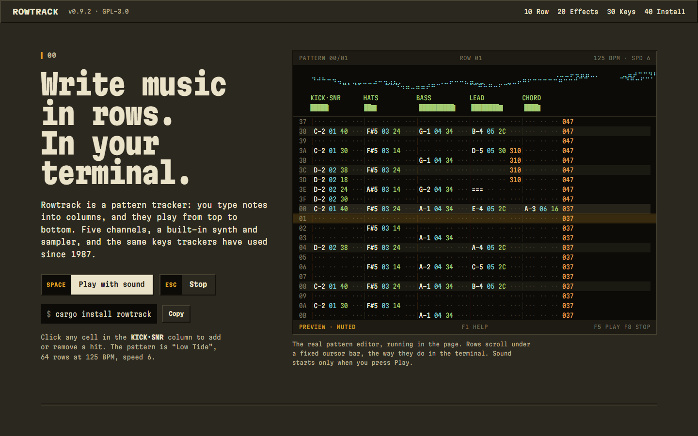
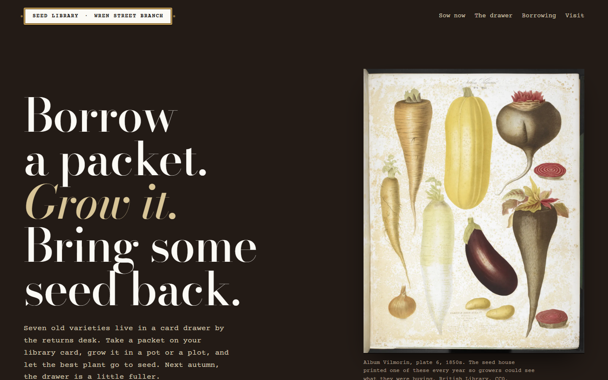

# Kern examples

Three fictional products, each built by running the [Kern method](../skills/kern/references/method.md) from the start. They were chosen to land at very different places on the [register](../skills/kern/references/register.md): one is made of text and sound, one of terrain, one of old engravings and paper. None of them uses an icon library, a component kit's buttons or a fade-up.

Each keeps its working notes in `.kern/record.md` (ground, tension, thesis, the median it left, the register and its materials, the system and the defended risk) and its fingerprint in `.kern/fingerprint.json`. Read the record first. It shows how the design was derived, which matters more than the result. They show reasoning, not templates.

| | Rowtrack | Skarvet 58 | Wren Street Seed Library |
|---|---|---|---|
| What | A terminal music tracker | A 58 km mountain race | A seed library in a branch library |
| Register | Spectacular, through text-mode and sound | Spectacular, through live 3D | Expressive, through archival plates and paper |
| Thesis | A tracker pattern scrolling in a terminal | The plaster relief model on the hut wall | The card drawer where every card is a plate |
| Rich materials | ASCII pattern, braille scope, block VU meters, Web Audio synth, QWERTY piano | Three.js terrain with contour shader, route that draws itself, profile scrubber, mini profiles | 1904 Vilmorin engravings, an 1850s chromolithograph, index cards, a violet date stamp |
| Left out on purpose | Photos, illustration, 3D | Photos, ASCII, sound | 3D, ASCII, sound, photos |
| Type | Martian Mono | Archivo across its width axis | Bodoni Moda, Courier Prime |
| Controls | Bevelled tracker keys with the shortcut on a cap | Red trail signposts; checkboxes as painted T blazes | Double-ruled typed labels; manila divider tabs |
| Signature motion | Rows scroll under a fixed cursor | The route draws itself round the massif | The due-back stamp lands on the card |

The three fingerprints are 7–10% similar to each other (`kern ledger compare`), and all three pass `kern audit` with 0 FAIL and 0 WARN.

[](rowtrack/)

[](skarvet/)

[](seed-library/)

## Run them

```sh
python -m http.server 18790 --bind 127.0.0.1
```

Then open:

- **Rowtrack:** <http://127.0.0.1:18790/examples/rowtrack/>. Press Space or "Play with sound", click cells in the KICK·SNR column, and play the keyboard in section 30.
- **Skarvet 58:** <http://127.0.0.1:18790/examples/skarvet/>. Drag to turn the massif (two fingers on touch), scrub the profile, and press "Show" on any checkpoint. It loads Three.js 0.160 from jsDelivr.
- **Wren Street Seed Library:** <http://127.0.0.1:18790/examples/seed-library/>. Change the month, borrow a packet and watch the stamp, and scroll through the drawer on a tall screen.

## How the register was read

- **Rowtrack** is a tool, but people decide to install a tracker by hearing one. Its subject is literally rows of characters, so text-mode animation passes the [relevance test](../skills/kern/references/register.md#the-relevance-test) and nothing else needed to.
- **Skarvet 58** sells an experience made of terrain. Depth carries the information runners plan by (where the climbs are), so live 3D earns the hero. Photographs were left out because none can honestly exist for a fictional massif.
- **The seed library** is a quiet civic service with a beautiful history. Its richness is in the plates of the exact varieties it lends and in the paper rituals of a library, so it stays still except for one stamp and the drawer itself.

## Kern critique

Each was scored with the [Kern Score](../skills/kern-critique/SKILL.md#the-kern-score) at web weights, in every theme it ships, at 1440 and 390 wide, after one look-and-fix round. The records list the defects fixed and the ones still holding each score down.

| | Thesis | Hierarchy | Composition | Type | Colour | Platform | Content | States | Craft | Distinct | Score |
|---|---|---|---|---|---|---|---|---|---|---|---|
| Rowtrack | 9 | 8 | 8 | 8 | 8 | 8 | 8 | 8 | 7.5 | 9 | 8.2 |
| Skarvet 58 | 9 | 9 | 8 | 8 | 8.5 | 8 | 8 | 8 | 7.5 | 9 | 8.4 |
| Seed library | 9 | 8 | 8 | 8.5 | 8 | 8 | 8 | 8 | 7.5 | 8.5 | 8.2 |

These are self-scored by the agent that built them. Re-score them blind before trusting the numbers.
